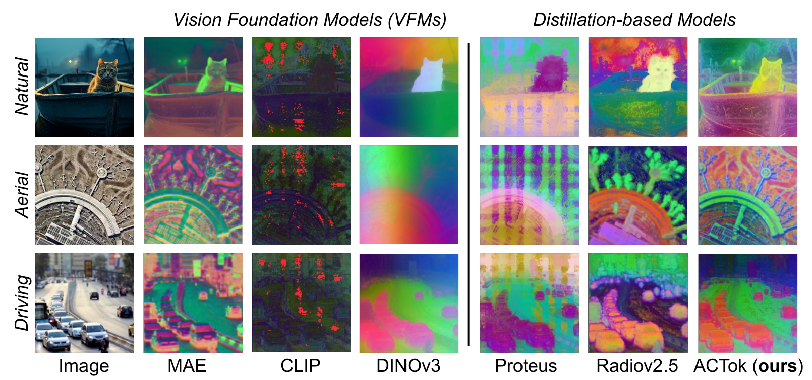
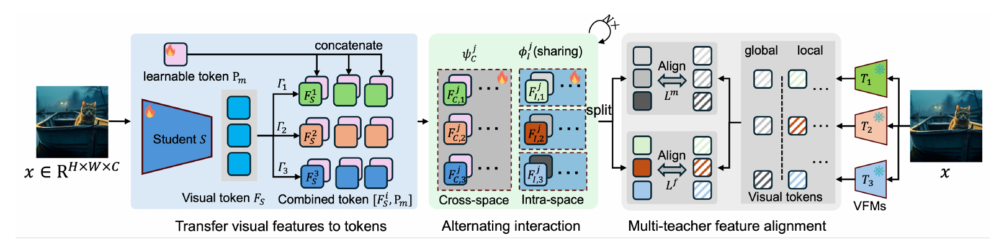

<div align="center">

# ACTok

### Aggregating Cross-Domain Knowledge via Learnable Tokens for Multi-Teacher Distillation

**Multiple vision experts. One versatile student.**

Wu Ran<sup>1</sup> · Weijia Zhang<sup>1</sup> · Shuyang Pang<sup>2</sup> · Jingsheng Liu<sup>2</sup><br>
Xiaohui Zhang<sup>2</sup> · Yichao Yan<sup>1</sup> · Chao Ma<sup>1,✉</sup>

<sup>1</sup> Shanghai Jiao Tong University &nbsp; <sup>2</sup> CISDI Information Technology

[Highlights](#highlights) · [Method](#method) · [Results](#results) · [Getting started](#getting-started) · [Citation](#citation)

</div>

ACTok brings the complementary strengths of **CLIP, MAE, and DINOv3** into a unified student. Learnable tokens bridge teacher-specific representation spaces, while alternating cross-space and intra-space interactions reconcile their knowledge. The framework supports **both CNN and ViT students**, using **only ImageNet-1K as the distillation dataset**.

<div align="center">
  
  <p><em>Complementary knowledge, visible in the details. ViT-B feature visualizations from Figure 1 of the paper.</em></p>
</div>

## Highlights

- **A small proxy dataset, a broad range of tasks.** Distillation uses 1.2M ImageNet-1K images, with evaluation on classification, fine-grained recognition, semantic segmentation, and depth estimation.
- **Tokens that connect visual experts.** Learnable neural proxies aggregate teacher knowledge through alternating interactions across and within representation spaces.
- **CNNs and Transformers, under one framework.** Evaluated with ResNet-50, ConvNeXt-B, ViT-B/16, and ViT-L/16 students, including ViT-to-CNN transfer.
- **Strong fine-grained transfer.** ACTok ViT-B reaches **94.4% on Caltech101** and **90.8% on CUB**. Relative to the RADIOv2.5-B results cited in the paper, it gains **7.6 percentage points on Aircraft** with over **1,000× fewer distillation images**.

The data comparison concerns the **student's distillation dataset**, not the pretrained teachers' data or total training compute. Results are reported by the manuscript; the compared methods use different teacher ensembles and student configurations.

## Method

<div align="center">
  
</div>

1. **Represent visual features as tokens.** CNN feature maps and ViT sequences are projected into teacher-specific spaces.
2. **Introduce learnable proxies.** A shared learnable token is concatenated along the channel dimension, allowing the framework to handle both architectural families.
3. **Alternate cross-space and intra-space interaction.** Cross-space modules exchange complementary knowledge; shared intra-space modules consolidate each representation.
4. **Align global and local knowledge.** Learnable-token alignment captures global semantics, while teacher-specific feature objectives preserve local information.

The aggregation modules sit after the student backbone. For downstream tasks, the paper uses the representation projected into the DINO space, retaining the knowledge consolidated by the interaction modules.

> **Code entry point:** `main_ViT.py` selects `ModelAggregator_ViT_combine.py`. This checkout also contains experimental variants; match the aggregation implementation and checkpoint when evaluating. The current combine variant includes relational losses beyond the manuscript's core objective.

## Results

### Transformer students

Selected results from **Table 1** of the manuscript. Classification values are accuracy (%), ADE20K uses linear-probing mIoU (%), and NYUv2 uses RMSE. Higher is better except for RMSE.

| Model | Distillation images | ImageNet ↑ | Aircraft ↑ | Caltech101 ↑ | CUB ↑ | ADE20K ↑ | NYUv2 ↓ |
| --- | --- | ---: | ---: | ---: | ---: | ---: | ---: |
| Proteus-B (ViT-B/14) | 1.2M | 84.9 | 91.0 | 91.9 | 90.5 | — | 0.304 |
| RADIOv2.5-B | ~1,400M | 84.8 | 83.5 | 91.2 | 85.9 | 48.9 | — |
| **ACTok-B (ViT-B/16)** | **1.2M** | **85.6** | **91.1** | **94.4** | **90.8** | **46.5** | **0.300** |
| Proteus-L (ViT-L/14) | 1.2M | 86.2 | 93.5 | 92.1 | 91.1 | — | 0.240 |
| RADIOv2.5-L | ~1,400M | 87.4 | 86.3 | 92.5 | 88.2 | 51.5 | — |
| **ACTok-L (ViT-L/16)** | **1.2M** | **87.5** | **92.1** | **93.8** | **91.4** | **50.3** | **0.258** |

Proteus and RADIOv2.5 numbers are their officially reported results as collected in the manuscript. ACTok-B improves over all three of its teachers on Caltech101 (**94.4%** vs. CLIP **90.7%**, MAE **91.6%**, and DINOv3 **93.5%**). Results vary by task: RADIOv2.5 retains higher ADE20K mIoU, and Proteus-L retains lower NYUv2 RMSE.

<details>
<summary><strong>CNN students and cross-architecture transfer</strong></summary>

Results from **Table 2**. An all-ViT teacher ensemble improves ConvNeXt-B over the all-CNN teacher setting on ImageNet, Aircraft, Caltech101, ADE20K, and NYUv2.

| ACTok student | Teacher family | ImageNet ↑ | Aircraft ↑ | Caltech101 ↑ | CUB ↑ | ADE20K ↑ | NYUv2 ↓ |
| --- | --- | ---: | ---: | ---: | ---: | ---: | ---: |
| ResNet-50 | ResNet-50 | 78.0 | 85.4 | 89.9 | 79.7 | 20.5 | 0.408 |
| ConvNeXt-B | ConvNeXt-B | 83.0 | 88.7 | 93.1 | 88.7 | 34.6 | 0.361 |
| ConvNeXt-B | ViT-B | 84.1 | 90.0 | 93.5 | 88.7 | 34.7 | 0.349 |

</details>

The paper also studies dataset scaling, multimodal transfer with LLaVA-1.5, and feature consistency across input resolutions from 512 × 512 to 4096 × 4096. The main limitations are proxy-dataset bias and the difficulty of transferring between different architectural families.

## Getting started

### Installation

Use a Python environment with Python 3.10 or later. Training requires a CUDA-enabled PyTorch environment; install matching PyTorch and torchvision builds for your CUDA installation, then install the remaining dependencies:

```bash
git clone https://github.com/VISION-SJTU/ACTok.git
cd ACTok
python -m venv .venv
source .venv/bin/activate
python -m pip install --upgrade pip
python -m pip install -r requirements.txt
```

`requirements.txt` lists dependencies found in the source; it is not a tested version lock. The installed Transformers version must support DINOv3, and PyTorch must support the AMP and distributed APIs used here. OpenAI CLIP is installed from its source repository.

## Data and teacher checkpoints

Training uses images without class labels from an ImageNet-style directory:

```text
/path/to/imagenet/
└── train/
    ├── class_0001/
    │   ├── image_0001.jpg
    │   └── ...
    └── ...
```

Pass the dataset root with `-data_path`. `datasets/dataset.py` loads the training split and applies random resized crops, horizontal flips, and ImageNet normalization. The current loader uses the entire training split; it does not implement dataset-ratio subsampling.

Prepare teacher weights locally:

| Teacher | Base configuration | Large configuration |
| --- | --- | --- |
| CLIP | OpenAI `ViT-B/16` | OpenAI `ViT-L/14` |
| DINOv3 | Local Hugging Face ViT-B/16 model directory | Local Hugging Face ViT-L/16 model directory |
| MAE | `pretrain/mae_pretrain_vit_base.pth` | `pretrain/mae_pretrain_vit_large.pth` |

CLIP is loaded through `clip.load` and may download weights on first use. Its corresponding `-teacher_pretrain` value is `none`; the local CLIP files in `pretrain/` are not used by this loader. A DINOv3 model directory must contain the model configuration and weights required by the Transformers loader. Obtain each teacher from its original distribution and comply with its access requirements and license.

Example local layout (weights remain ignored by Git):

```text
pretrain/
├── mae_pretrain_vit_base.pth
├── mae_pretrain_vit_large.pth
├── dinov3-vitb16-pretrain-lvd1689m/
│   ├── config.json
│   └── model.safetensors
└── dinov3-vitl16-pretrain-lvd1689m/
    ├── config.json
    └── model.safetensors
```

Verify the MAE path before training: the current MAE wrapper skips checkpoint loading if the file is missing.

## Training

### Paper configuration

The manuscript reports the following distillation setup (Section 4.1):

| Setting | ResNet-50 | ConvNeXt-B | ViT-B/16 | ViT-L/16 |
| --- | --- | --- | --- | --- |
| Proxy dataset | ImageNet-1K | ImageNet-1K | ImageNet-1K | ImageNet-1K |
| Epochs / input resolution | 300 / 224 × 224 | 300 / 224 × 224 | 300 / 224 × 224 | 300 / 224 × 224 |
| Batch size | 1024 | 1024 | 1024 | 512 |
| Learnable token dimension | 1024 | 512 | 512 | 768 |
| Alternating interaction stages | 2 | 2 | 1 | 1 |

Shared settings: AdamW, learning rate **1e-4**, weight decay **0.01**, mixed precision, and four NVIDIA A800 80 GB GPUs. During downstream adaptation, the paper scales the interaction modules' learning rate by **0.1×** and uses features projected into the DINO space.

### Launch example

Run commands from the repository root. The example below configures a ViT-B student and three teachers on one GPU. Adjust the batch size to fit GPU memory.

```bash
CUDA_VISIBLE_DEVICES=0 torchrun --standalone --nproc_per_node=1 main_ViT.py \
  -distributed -backbone vit_b \
  -teacher_type clip-clip_b dinov3-dinov3_b mae-mae_b \
  -teacher_pretrain none pretrain/dinov3-vitb16-pretrain-lvd1689m pretrain/mae_pretrain_vit_base.pth \
  -data_path /path/to/imagenet \
  -batch_size 32 -epoch 300 -num_workers 8 \
  -in_dim 768 -dim 768 -out_dims 512 768 768 -token_dim 512 \
  -lr 0.0001 -weight_decay 0.01 -clip_grad 0.05 \
  -output_dir logs/actok_vit_b
```

Teacher order matters: use **CLIP, DINOv3, MAE** for this aggregation implementation, and keep `-teacher_pretrain` and `-out_dims` in the same order. The loss branches consume teacher indices in this order.

For multiple GPUs, set `CUDA_VISIBLE_DEVICES=0,1,2,3` and `--nproc_per_node=4`. `-batch_size` is per process; `-grad_accu` controls gradient accumulation. For ViT-L, use `vit_l`, `clip-clip_l dinov3-dinov3_l mae-mae_l`, the large teacher checkpoints, `-in_dim 1024 -dim 1024 -out_dims 768 1024 1024 -token_dim 768`.

These are launch examples derived from the code, not verified paper reproduction settings. The existing `train_*.sh` files retain local experiment paths and resume arguments; adapt them before use.

### Outputs and resuming

The entry point appends the joined teacher names to `-output_dir`. For the example above, outputs are stored under:

```text
logs/actok_vit_b/clip-clip_b_dinov3-dinov3_b_mae-mae_b/
├── checkpoint.pth       # full aggregation model, optimizer, scheduler, AMP state
├── backbone.pth         # student backbone state dictionary only
├── log.txt              # per-epoch training statistics
└── conflict_history.csv # gradient-conflict measurements
```

Resume by adding the following to the same training command:

```bash
-resume logs/actok_vit_b/clip-clip_b_dinov3-dinov3_b_mae-mae_b/checkpoint.pth
```

Keep the model configuration and teacher order consistent with the checkpoint. `backbone.pth` contains only the student; the aggregation prediction heads require the full checkpoint and its matching aggregation variant.

## Evaluation and visualization

- `downstream/fine_grained/` provides linear evaluation on 12 classification datasets. See its [README](downstream/fine_grained/README.md), configure the model/checkpoint in `run_all_datasets.sh`, and run it from that directory. The evaluator additionally imports RAPIDS cuML; install a CUDA-compatible cuML environment separately. Its supplied model choices and checkpoint loading must be adapted for the ACTok representation being evaluated.
- `feat_visualization.py`, `test_pca.py`, and `video_pca.py` provide feature visualization utilities. Update their image, checkpoint, and output paths before running. The `test_*.py` files are experiment scripts, not an automated test suite.
- `gradient_conflict_tracker.py` and `measure_gradient_conflict.py` inspect disagreement between teacher objectives. Plotting scripts support experimental analysis.

The ADE20K, depth, and ImageNet evaluation folders currently have no implementation in this checkout.

## Code structure

```text
backbone/                       # ViT, MAE, CLIP, DINOv3, ConvNeXt, and ResNet wrappers
datasets/                       # image loading and training transforms
layers/                         # cross-model blocks, heads, and auxiliary losses
main_ViT.py                     # current ViT training entry point
ModelAggregator_ViT_combine.py  # aggregation implementation selected by main_ViT.py
ModelAggregator_ViT*.py         # alternative ViT aggregation experiments
DirectAlign_ViT.py              # direct-alignment experiment
main_conv.py, main_ConvViT.py    # convolutional and mixed-backbone training
downstream/fine_grained/        # classification evaluation
comparison/                    # comparison-model utilities
```

## Release status

- [x] Training source and aggregation variants
- [x] Paper overview, qualitative comparisons, and reported results
- [x] Installation and launch instructions
- [ ] Downloadable ACTok checkpoints
- [ ] Complete evaluation pipelines for the paper benchmarks
- [ ] Validated environment lock and end-to-end reproduction recipe

Teacher weights and trained checkpoints remain local and are excluded from Git. Paper settings above describe the manuscript experiments; this source release has not yet been validated end to end in a pinned environment.

## Citation

If ACTok is useful for your research, please cite our manuscript. The entry below uses the author names as printed in the manuscript; publication metadata will be updated when available.

```bibtex
@misc{actok2026,
  title  = {Aggregating Cross-Domain Knowledge via Learnable Tokens for Multi-Teacher Distillation},
  author = {{Wu Ran} and {Weijia Zhang} and {Shuyang Pang} and {Jingsheng Liu} and {Xiaohui Zhang} and {Yichao Yan} and {Chao Ma}},
  year   = {2026},
  note   = {Research manuscript},
  url    = {https://github.com/VISION-SJTU/ACTok}
}
```

## Acknowledgments

This repository includes or adapts components from CLIP, MAE, DINOv3, timm, and other research implementations. Fine-grained evaluation builds on SynCLR. Original attribution and license notices are retained in the relevant source files; third-party components and weights remain subject to their respective licenses.
